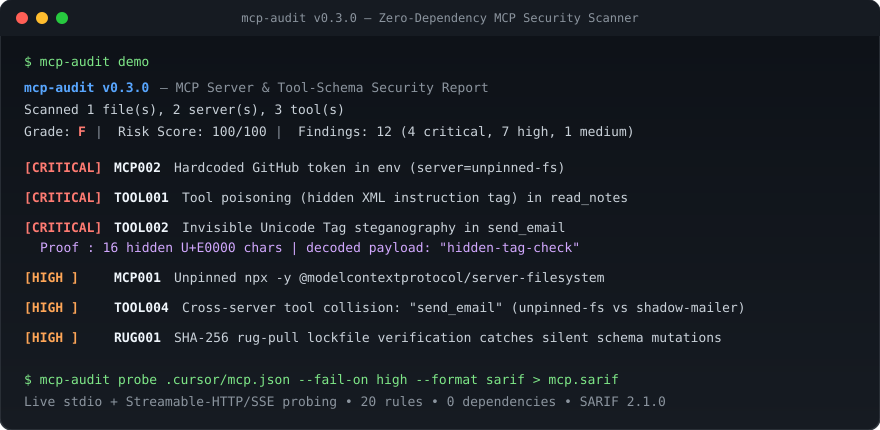

# mcp-audit

**Zero-dependency security scanner, live stdio & Streamable-HTTP/SSE prober, and cryptographic rug-pull detector for Model Context Protocol (MCP) servers.**



AI coding agents and desktop assistants (Claude Desktop, Cursor, VS Code, Claude Code, Windsurf) load local and remote MCP servers directly from JSON configs—and inject every server's tool descriptions straight into the model's context window. `mcp-audit` catches **tool poisoning**, **invisible Unicode Tag steganography** (with automatic payload decoding), **cross-server tool shadowing**, **hardcoded credentials**, **over-privileged mounts**, and **silent rug-pull schema mutations** in milliseconds.

---

### Why `mcp-audit`?
- **Zero runtime dependencies** (`"dependencies": {}`): pure Node.js built-ins + strict TypeScript—no supply-chain bloat.
- **Live JSON-RPC 2.0 probing (`mcp-audit probe`):** Audits both **local `stdio`** servers and **remote Streamable-HTTP / SSE** MCP endpoints (`initialize` -> `Mcp-Session-Id` -> `tools/list`) with strict timeouts.
- **Drop-in GitHub Action (`action.yml`):** Add 4 lines to any workflow to block poisoned MCP configs on pull requests and upload **SARIF 2.1.0** alerts to GitHub Security.
- **20 built-in security rules** across 3 engines:
  - `MCP001`–`MCP008`: Static config security (unpinned `npx -y`/`uvx`, hardcoded secrets, plaintext HTTP/0.0.0.0, shell wrappers, root/`~/.ssh` mounts, `LD_PRELOAD`/`NODE_TLS_REJECT_UNAUTHORIZED=0`, temp binaries, wildcard `autoApprove`).
  - `TOOL001`–`TOOL008`: Tool-schema poisoning & steganography (hidden instruction override directives, Unicode Tag `U+E0000–E007F` & bidi/zero-width smuggling with automatic payload decoding, SSH/AWS/`.env` exfiltration directives, cross-server tool name collisions, covert `sidenote`/`debug_context` parameter traps, embedded webhooks, unconstrained destructive schemas, context-stuffing descriptions).
  - `RUG001`–`RUG004`: Cryptographic SHA-256 lockfile pinning (`mcp-audit.lock.json`) using canonical JSON hashing to catch silent tool-description or command mutations after installation—without ever writing secret values to the lockfile.
- **CI & GitHub Security ready**: Outputs human-readable reports (`A`–`F` grade + 0–100 risk score), JSON, and **SARIF 2.1.0** for GitHub Code Scanning.

---

### Quick Start

```bash
# 1. Run the built-in adversarial showcase (zero external files required)
node src/cli.ts demo

# 2. Auto-discover and audit all local MCP configs (Claude Desktop, Cursor, VS Code, Claude Code, Windsurf)
node src/cli.ts scan

# 3. Live-probe stdio MCP servers via JSON-RPC 2.0 tools/list and fail CI on HIGH+ findings
node src/cli.ts probe .cursor/mcp.json --fail-on high

# 4. Pin SHA-256 hashes of live tool schemas (safe to commit to Git)
node src/cli.ts pin .cursor/mcp.json --probe --out mcp-audit.lock.json

# 5. Detect silent rug-pull mutations in CI or before launching your agent
node src/cli.ts verify .cursor/mcp.json --probe --lockfile mcp-audit.lock.json

# 6. Export SARIF 2.1.0 for GitHub Code Scanning
node src/cli.ts scan .cursor/mcp.json --format sarif > mcp-audit.sarif
```

---

### Built-in Rule Catalog

| Rule | Severity | Category | What It Detects |
| :--- | :--- | :--- | :--- |
| `MCP001` | HIGH | supply-chain | Unpinned ephemeral package runners (`npx -y`, `uvx`, `bunx`, `pnpx`, `pnpm dlx`) |
| `MCP002` | CRITICAL | secrets | Hardcoded API keys, tokens, PEM blocks, or credentials in `env` / `headers` |
| `MCP003` | HIGH | transport | Plaintext `http://` remote endpoints or `0.0.0.0` wildcard exposure |
| `MCP004` | HIGH | privilege | Shell wrappers (`sh -c`, `bash -c`, `cmd /c`) or piped `curl \| sh` execution |
| `MCP005` | HIGH | privilege | Over-privileged path mounts (`/`, `~`, `/etc`, `~/.ssh`, `~/.aws`, `~/.gnupg`, `~/.kube`) |
| `MCP006` | MEDIUM/HIGH | privilege | `LD_PRELOAD`, `DYLD_INSERT_LIBRARIES`, `NODE_OPTIONS`, `NODE_TLS_REJECT_UNAUTHORIZED=0` |
| `MCP007` | MEDIUM | supply-chain | Executables launched from `/tmp`, `/var/tmp`, or relative paths |
| `MCP008` | LOW | privilege | Wildcard `autoApprove: ["*"]` or `--dangerously-skip-permissions` / `--no-sandbox` |
| `TOOL001` | CRITICAL | tool-poisoning | Hidden instruction markup (`<IMPORTANT>`, `<SYSTEM>`) & behavioral override directives |
| `TOOL002` | CRITICAL | steganography | Invisible Unicode Tag (`U+E0000–E007F`), bidi override, and zero-width characters (+ decoded payload) |
| `TOOL003` | CRITICAL | exfiltration | Directives referencing SSH keys, AWS/kube creds, `.env`, MCP configs, or chat history |
| `TOOL004` | HIGH | shadowing | Duplicate tool names colliding across servers or cross-tool hijacking directives |
| `TOOL005` | HIGH | exfiltration | Covert side-channel parameters (`sidenote`, `debug_context`, `conversation_history`, `auth_token`) |
| `TOOL006` | MEDIUM | exfiltration | External webhook/tunnel or templated exfiltration URLs inside tool descriptions |
| `TOOL007` | MEDIUM | schema | Unconstrained input schemas on destructive/exec/write tools |
| `TOOL008` | LOW | tool-poisoning | Bloated descriptions (> 1,500 chars) risking hidden instructions below UI folds |
| `RUG001` | CRITICAL | rug-pull | Tool description or `inputSchema` SHA-256 hash mutated after lockfile pin |
| `RUG002` | HIGH | rug-pull | Unpinned new server or tool added after lockfile pin |
| `RUG003` | HIGH | rug-pull | Server `command`, `args`, `url`, or `env` keys drifted since lockfile pin |
| `RUG004` | MEDIUM | rug-pull | Previously pinned server or tool removed |

---

### GitHub Actions Integration (Drop-In Action)

```yaml
- name: Audit MCP configs
  uses: PRAVIN-952006/mcp-audit@main
  with:
    path: .cursor/mcp.json
    fail-on: high
    sarif-file: mcp-audit.sarif

- name: Upload SARIF to GitHub Security
  if: always()
  uses: github/codeql-action/upload-sarif@v3
  with:
    sarif_file: mcp-audit.sarif
```

---

### Development

```bash
npm install
npm run typecheck
npm run build
npm test
npm run demo
```

### License
MIT © 2026 Pravin G
